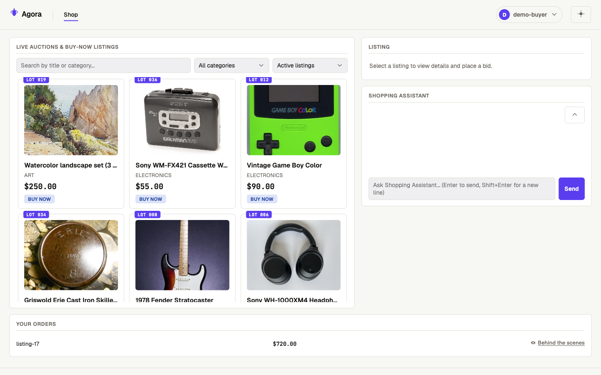

# Agora Demo

[](https://github.com/day0ops/agora-demo/actions/workflows/ci.yml)
[](LICENSE)

A live buy/sell and auction marketplace demo for kagent Agent Substrate and agentgateway Enterprise. Buyer and seller AI concierges run as Substrate actors, with agentgateway providing multi-provider LLM failover, budget and rate-limit enforcement, PII guardrails, RFC 8693 token exchange, and zero-code MCP tool generation from a REST OpenAPI spec.



This repository is the application tier: the `catalog-api` backend, five purpose-built MCP servers, and the Agora marketplace console. The deployment glue that runs it on a cluster lives in [`agentic-field-kit`](https://github.com/day0ops/agentic-field-kit).

> [!NOTE]
> The application tier is complete. Wiring it into `agentic-field-kit` (deployment profile, features, and usecase spec), and the Agent Journey and Operator Studio surfaces that need a live Agent Substrate cluster, are tracked separately.

## Components

| Path | Purpose |
|---|---|
| `fixtures/` | Shared synthetic dataset (sellers, buyers, listings, bids, orders). |
| `catalog-api/` | REST API owning all listing, bid, and order data. agentgateway wraps its OpenAPI surface into `listings-mcp` directly, with no MCP server code. |
| `trust-scoring/` | Bid risk scoring shared by `catalog-api` (in-process check on every bid) and `trust-mcp`. |
| `mcp-servers/catalog-mcp/` | `search_listings`: buyer-facing search over actionable listings (open auctions and live buy-nows) by category, price range, and keyword. |
| `mcp-servers/bids-mcp/` | Place and withdraw bids, set a standing auto-bid ceiling, bid history, current price. |
| `mcp-servers/pricing-mcp/` | `suggest_price` for sellers: real comps from sold listings, falling back to a static baseline with no sales history. |
| `mcp-servers/orders-mcp/` | `checkout`, `get_order`, `list_orders`. |
| `mcp-servers/trust-mcp/` | `score_bid_risk` and `check_seller_reputation`. |
| `console/` | Marketplace console: Go backend plus embedded React SPA with buyer (`/shop`), seller (`/sell`), and operator (`/ops`) views. |

Every MCP server is a thin client over `catalog-api` and holds no data of its own. `listings-mcp` covers the raw CRUD surface; `catalog-mcp` exists for buyer search semantics that do not map cleanly onto a single REST endpoint. Bid risk scoring is a local heuristic behind a swappable `RiskScorer` interface, pending API access to TypeSafe.ai's Jev model.

> [!TIP]
> See [docs/design.md](docs/design.md) for the `catalog-api` and console API references, the Jev extension point, the agent-invocation integration, the console's design system, and the Execution Drawer and Operator Studio details.

## Development

> [!IMPORTANT]
> `console/main.go` embeds the built frontend (`//go:embed all:web/dist`), so building, vetting, or testing the `console` package requires `console/web/dist` to exist first:
>
> ```bash
> cd console/web && npm install && npm run build
> ```

```bash
go work sync
go build $(go list -m -f '{{.Dir}}/...')
go test $(go list -m -f '{{.Dir}}/...')
golangci-lint run $(go list -m -f '{{.Dir}}/...')
```

The workspace has no root module, so a bare `./...` from the repo root matches nothing. `go list -m` expands to every module in `go.work`.

Run the catalog API locally:

```bash
cd catalog-api && go run .
# listening on :8080
```

Run the console locally (after building the frontend), pointed at the local catalog-api:

```bash
cd console && CATALOG_API_URL=http://localhost:8080 go run .
# listening on :8090 - open http://localhost:8090
```

To chat with live agents, also set `AGENTGATEWAY_BASE_URL` to agentgateway's kagent A2A route, including the `/agents/<namespace>` prefix.

> [!TIP]
> For frontend-only iteration with hot reload, `cd console/web && npm run dev` proxies `/api` and `/account` to `http://localhost:8090` (see `vite.config.ts`).

## License

Apache-2.0. See [LICENSE](LICENSE).
